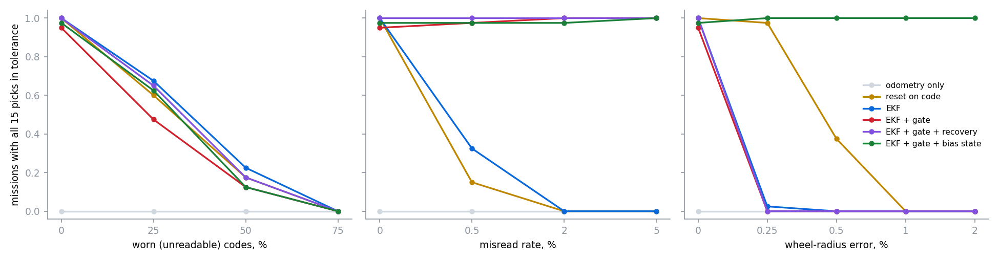
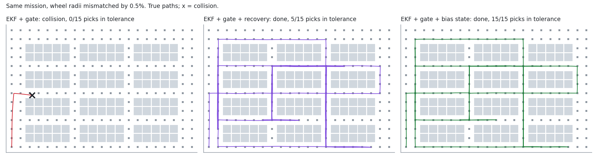

# warehouse-fiducial-navigation

A Kiva-style warehouse robot drives a grid of 1 m aisles between two-deep
shelf blocks and carries out 15 pick tasks per mission. It localises by
reading floor codes with a downward camera and fusing them with wheel
odometry. It plans with A* and drives corner to corner on its own estimate.
At each pick face it must stop within **3 cm and 2°**. The aisles leave
**25 cm of clearance** on each side of the robot, so localisation error turns
into collisions quickly.

Six localisers are run on identical seeded missions across three sweeps:
worn codes, code misreads and wheel-radius miscalibration.


This is a simulation study. The code reader is a model, not a decoder
running on images, and there is no robot behind the numbers. The 3 cm pick
tolerance, the 25 cm aisle clearance and the noise levels are chosen
parameters, not measurements from a real system.

---

## Result



Each cell below is 40 seeded missions of 15 picks. The headline number is
the count of missions in which **all 15 picks landed in tolerance**, with
collisions shown alongside. Full table, including median localisation
error: [`docs/benchmark.txt`](docs/benchmark.txt).

**Misread codes.** A misread decodes the wrong id, so the reported pose is
exactly one cell off, in a perfectly plausible place.

| misread rate | 0 % | 0.5 % | 2 % | 5 % |
|---|---:|---:|---:|---:|
| reset on code | 40 · 0 coll. | 6 · 11 | 0 · 31 | 0 · 40 |
| EKF, no gate | 40 · 0 | 13 · 0 | 0 · 1 | 0 · 20 |
| EKF + χ² gate | 38 · 1 | 39 · 1 | 40 · 0 | 40 · 0 |
| EKF + gate + recovery | 40 · 0 | 40 · 0 | 40 · 0 | 40 · 0 |
| EKF + gate + bias state | 39 · 0 | 39 · 0 | 39 · 0 | 40 · 0 |

Odometry alone collides in all 40 missions under every condition. The
Mahalanobis gate (χ²(3) at 99.9 %) rejects every 1 m misread, because the
filter is never 1 m unsure. Without it, a 0.5 % misread rate already ruins
most missions.

**Wheel-radius mismatch.** The left wheel is (1 + e)·r and the right wheel
(1 − e)·r, so a commanded straight line becomes an arc.

| radius error | 0 % | 0.25 % | 0.5 % | 1 % | 2 % |
|---|---:|---:|---:|---:|---:|
| reset on code | 40 · 0 | 39 · 0 | 15 · 0 | 0 · 0 | 0 · 0 |
| EKF, no gate | 40 · 0 | 1 · 0 | 0 · 0 | 0 · 3 | 0 · 40 |
| EKF + χ² gate | 38 · 1 | **0 · 40** | 0 · 40 | 0 · 40 | 0 · 40 |
| EKF + gate + recovery | 40 · 0 | 0 · 0 | 0 · 0 | 0 · 2 | 0 · 27 |
| **EKF + gate + bias state** | 39 · 0 | **40 · 0** | **40 · 0** | **40 · 0** | **40 · 0** |



The gate that made the filter immune to misreads is what kills it here. A
0.25 % radius error, a quarter of a millimetre on a 100 mm wheel, gives
0.01 rad of heading drift per metre. The filter's motion model treats drift
as zero-mean noise, so its heading uncertainty grows more slowly than its
actual heading error. Within a few metres, every correct code reading falls
outside the gate. From then on the filter rejects exactly the measurements
that would rescue it, and the robot drives into a shelf on odometry alone
(**40 of 40 missions collide**). Even on a perfectly calibrated robot, the
gated filter locked itself out in 2 of 40 missions from random noise alone.

Two fixes:

- **Recovery.** After five consecutive rejected readings that agree with
  each other, the filter re-initialises from the code. This removes the
  collisions up to 1 % but not the mis-picks, because the bias is still
  there between codes.
- **Bias state.** A fourth filter state estimates heading drift per metre
  from the code readings. The estimate is removed from odometry and fed
  forward into the steering command. That gives 40/40 perfect missions up to
  a 2 % mismatch. Without the feed-forward, the bias-aware filter still
  mis-picked: the robot knew where it was, but the proportional cross-track
  controller settled about 2 cm off the line fighting the bias. Knowing the
  bias and *steering against it* are separate steps.

**Worn codes.** A random fraction of floor codes is unreadable.

| worn codes | 0 % | 25 % | 50 % | 75 % |
|---|---:|---:|---:|---:|
| EKF, no gate | 40 · 0 | 27 · 0 | 9 · 2 | 0 · 11 |
| EKF + gate + recovery | 40 · 0 | 26 · 0 | 7 · 2 | 0 · 10 |
| EKF + gate + bias state | 39 · 0 | 25 · 0 | 5 · 2 | 0 · 27 |

No localiser fixes this, and the table should be read that way. At 25 %
worn, the failures are almost all single mis-picks at stations whose own
code is worn, where the final stop is made on odometry from the last code a
metre or more back. That averages 0.35 mis-picks per mission for the
recovery filter, with no collisions. At 75 % worn, the bias-state filter
collides the most (27 of 40). With corrections that sparse, its extra state
is poorly constrained and can absorb a wrong bias.

The practical result is a maintenance rule, not an algorithm: **keep the
codes at the pick faces readable**.

---

## What is modelled

| part | file | what it does |
|---|---|---|
| floor | [`layout.py`](src/warehouse/layout.py) | 21 × 14 grid, three shelf blocks per band, 1-cell aisles, a code at every free cell centre, A* over (cell, heading) with a turn penalty, clearance to shelf footprints |
| robot | [`robot.py`](src/warehouse/robot.py) | true differential drive with wheel-radius errors; encoders with 1 % noise converted through the *nominal* radius; downward code reader (±15 cm field of view, 3 mm / 0.5° noise, 2 % missed reads, misreads to a neighbouring code) |
| localisers | [`localize.py`](src/warehouse/localize.py) | odometry only; reset on code; EKF; EKF + χ² gate; + recovery; + heading-drift bias state |
| missions | [`sim.py`](src/warehouse/sim.py) | 15 random pick faces, A* replan from the estimated cell, rotate-then-drive controller with cross-track correction, 3 mm final stop, rotate to face, check against truth |

Tests (17) cover several independent checks:

- calibrated odometry reproduces the truth exactly without noise
- a 0.5 % mismatch curves a straight line by the predicted −2e/b rad/m
- a code reading inverts to the robot pose
- a misread is exactly one spacing off
- the gate rejects a misread while the ungated filter accepts it
- the bias state learns −0.02 rad/m on a loop of the warehouse
- A* paths are connected, free and shortest
- the gated filter crashes under miscalibration while the bias-state filter
  completes the same mission

```bash
pip install -r requirements.txt
pytest -q
python examples/benchmark.py --seeds 40     # about 12 minutes on 8 cores
python examples/make_figures.py
```

## Limits

- Code reading is modelled: there is no decoder, motion blur or partial
  code.
- The robot is kinematic, with no wheel slip, acceleration limits or load.
- Only one systematic odometry error is modelled, the left/right radius
  difference. A symmetric scale error and a wheelbase error are not swept.
- Only one robot. No traffic, reservations or multi-robot deadlock. That is
  the territory of
  [swarm-path-planning](https://github.com/Pratyush150/swarm-path-planning).
- The pick check is a pose tolerance. There is no shelf lifting or
  under-shelf alignment camera.
- No ROS 2 node.

## License

MIT
